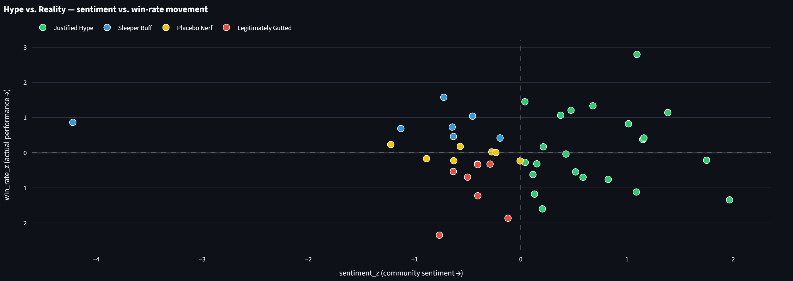
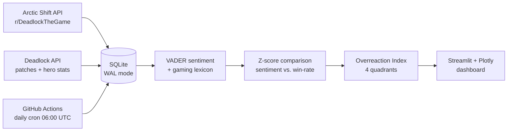

# 🎮 Deadlock — Hype vs. Reality

**A patch & sentiment tracker that quantifies whether post-patch community outrage actually matches hero win-rate shifts.**

[](https://www.python.org/)
[](https://streamlit.io/)
[](https://plotly.com/)
[](LICENSE)
[](.github/workflows/daily_refresh.yml)

[🚀 Live Demo ](https://deadlock-hype-tracker.streamlit.app)

## The problem

After every *Deadlock* patch, r/DeadlockTheGame erupts over which hero got "gutted" or is "broken." But community outrage is noisy and often wrong. This project joins two independent signals — **community sentiment** and **real win-rate movement** and answers one question: *is the hype backed by reality?*

## Dashboard preview



> A Plotly quadrant chart plotting **sentiment z-score** against **win-rate z-score**. Top-right is "Justified Hype," bottom-left "Legitimately Gutted" — and the off-diagonal corners expose where the community's read diverges from the numbers.

## How it works



## Key features

- **Overreaction Index** — scores all 44 heroes as *Justified Hype*, *Sleeper Buff*, *Placebo Nerf*, or *Legitimately Gutted*, computed as `sentiment_z − win_rate_z`.
- **Gaming-aware sentiment** — VADER extended with MOBA slang (`broken`, `gutted`, `unplayable`, `cracked`, `op`, `buffed`, …) so "this hero is broken" scores correctly.
- **Zero-auth by design** — no API keys, no `.env`, no paid services. `git clone` and run.
- **Self-refreshing** — a GitHub Actions cron rescrapes daily and commits the updated `deadlock.db` back to `main`, so the hosted demo stays current without a live backend.
- **Idempotent SQLite** — WAL mode with `INSERT OR REPLACE` / `ON CONFLICT DO UPDATE`; re-runs are always safe.

## Quickstart

```bash
git clone https://github.com/nikolasR1/deadlock-hype-tracker.git
cd deadlock-hype-tracker
python -m venv .venv && source .venv/bin/activate   # Windows: .venv\Scripts\activate
pip install -r requirements.txt
python scripts/run_pipeline.py --source all          # scrape + compute (~1-2 min)
streamlit run app.py                                 # http://localhost:8501
```

## Project layout

```
deadlock-hype-tracker/
├── app.py                       # Streamlit + Plotly dashboard
├── analytics/overreaction.py    # VADER sentiment + z-score Overreaction Index
├── db/schema.py                 # SQLite schema (5 tables, WAL mode)
├── scrapers/
│   ├── fetch_patches.py         # Deadlock API → patches + hero/item change tags
│   ├── fetch_reddit.py          # Arctic Shift → r/DeadlockTheGame posts + comments
│   └── fetch_stats.py           # Deadlock API → daily hero win/pick rates
├── scripts/run_pipeline.py      # CLI: --source [all|patches|reddit|stats|analytics]
├── data/deadlock.db             # committed snapshot (so the demo has data)
├── .github/workflows/           # daily auto-refresh cron
└── requirements.txt
```

## The data

| Table | What it holds |
|---|---|
| `patches` | Patch notes, release dates, raw text |
| `patch_changes` | Structured hero/item change tags (buff / nerf / rework / bugfix) |
| `reddit_posts` | Posts + top comments from r/DeadlockTheGame |
| `hero_stats` | Daily win-rate / pick-rate snapshots per hero |
| `hero_overreaction_metrics` | The computed Overreaction Index per hero |

## License

[MIT](LICENSE)
